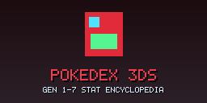
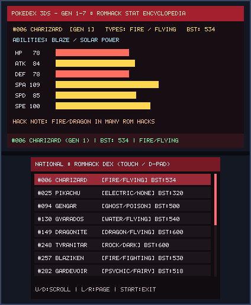
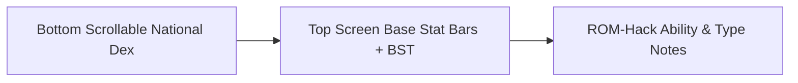

# Pokedex 3DS (`3ds_pokedex`)

<p align="center">
  
  &nbsp;&nbsp;&nbsp;
  
</p>

<p align="center">
  
</p>

> **Gen 1-7 Stat Encyclopedia (`CTR-P-PKDX`, UniqueId `0x0D3EC`)** — Part of the [**lafiabrew**](https://github.com/orgs/lafiabrew/repositories) Nintendo 3DS Homebrew Suite.

On-console competitive & ROM-hack Pokédex encyclopedia displaying base stats (`HP/Atk/Def/SpA/SpD/Spe`), BST, abilities, and Drayano/ROM-hack notes.

---

## Architecture & Data Flow



---

## Controls & Touch Ergonomics

| Button / Input | Action |
|---|---|
| `D-Pad Up / Down` (or Touch Row) | Scroll through Pokémon entries |
| `D-Pad Left / Right` | Page jump 4 entries up/down |
| `Top Screen` | Displays color-coded base stat bars, BST sum, abilities, and ROM-hack notes |

---

## Build, Verify & Install

```bash
make test
make 3ds && make verify-3ds
make qr
```
